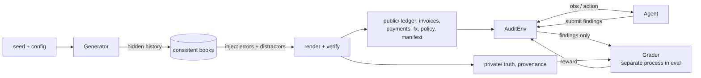

# auditgym — an RL environment for AI financial auditors

[](https://github.com/Goslinuly/fintech-auditgym/actions/workflows/ci.yml)
[](https://goslinuly.github.io/fintech-auditgym/)


**auditgym** is a reproducible, Gym-style reinforcement-learning environment for AI agents that
audit a company's books. Every episode is a fictional company with a month of ledger entries,
invoices, payments and FX rates; some of the records contain hidden accounting errors. The agent
investigates through a small set of tools under a step budget and submits findings, which are
scored against a hidden reference answer.

**Live explorer:** [goslinuly.github.io/fintech-auditgym](https://goslinuly.github.io/fintech-auditgym/)
(static mirror) · [Railway (live server, any seed)](https://explorer-production-573177ce.up.railway.app)
· add `?review=1` to see the hidden answer key.

> Built during a FinTech-track hackathon (19–22 Nov 2026). Work in progress — see
> [Hackathon context](#hackathon-context).

## The problem

LLM agents are increasingly pitched for finance back-office work, but there is no cheap,
honest way to measure whether an agent can actually *find and prove* an accounting error.
Real ledgers are confidential and unlabeled; hand-written puzzles are tiny and leak their answers.
auditgym generates unlimited labeled companies from a seed, with:

- **ground truth by construction** — errors are injected into a consistent hidden history, and an
  independent reference auditor must re-derive exactly the declared issues from public records only;
- **no answer leakage** — the agent never sees the answer key, provenance or seed (enforced by tests);
- **byte-for-byte reproducibility** — same seed + config + version → same files, transitions and rewards;
- **a reward that resists gaming** — spamming findings, guessing IDs or writing a persuasive
  explanation does not pay.

All data is synthetic: company and customer names are built from random syllables, amounts and
IDs are random. This is a benchmark, not an audit opinion.

## Environment design



### Observation space

`reset(seed, config)` (or `reset(episode_dir=...)`) returns the task text, `episode_id`, `manifest`
(currencies and their decimal exponents, period, timezone, rounding), the accounting `policy`,
table sizes and the action list, with `steps_remaining = 100`. Each `step` returns
`{step, steps_remaining, action, result | error}`. `info` is always exactly
`{episode_id, env_version, config_version}`. Everything is plain JSON; schemas are in
[`schemas/`](schemas/).

### Action / tool space

| Action | Arguments | Returns |
| --- | --- | --- |
| `list_records` | `table` ∈ {ledger, invoices, payments, fx}, `cursor`, `limit ≤ 50` | a page of records + opaque stable cursor |
| `get_record` | `table`, `id` | one record or `not_found` |
| `get_document` | `doc_id` (`DOC-…`, `INV-…`, `PAY-…`) | full invoice (with line items) or payment |
| `calculator` | `expression` (`+ - * / ( )`, decimals) | exact `Decimal` result — own parser, no `eval` |
| `submit` | `findings` | ends the episode |

Every action — valid, invalid or `submit` — costs one step; 100 steps or 60 s per episode, then
`truncated = true` and an empty report is scored. Errors carry a fixed message that never reveals
existing IDs, paths or stack traces. No shell, SQL, file or network access.

### Error taxonomy

| Type | What is wrong | `affected_ids` | Amount |
| --- | --- | --- | --- |
| `duplicate_invoice` | the same invoice (customer, lines, total) booked twice under a new number | the later copy | duplicate total |
| `payment_allocation` | a receipt not applied (or partly applied) to the invoice it pays | payment + invoice | unapplied remainder |
| `fx_conversion` | foreign-currency document converted at the wrong date's rate | the document | \|booked − correct\| in base currency |
| `period_cutoff` | a document from another period booked in this one (often a timezone trap) | the document | booked amount |

Two **interacting scenarios** stack several errors on one record (e.g. a foreign-currency
payment minutes after period end: cutoff + partial allocation + wrong FX date). **Distractors**
look suspicious but are correct: split payments, honest partial payments, weekly invoices with
equal amounts, refunds, documents near the period boundary in UTC, weekend documents at Friday's
rate. Some companies are fully clean. Details: [`docs/generator.md`](docs/generator.md).

### Reward

A finding matches a hidden issue only if type, normalized `affected_ids`, currency and amount
(within tolerance) agree **and** the `evidence_ids` contain a sufficient evidence set.

```
reward = clip(2·F1 − 1 − 0.002 · inspection_steps, −1, 1)
```

Exploration reward is 0; the terminal reward is returned only in `train` mode (in `eval` it goes
to the grader log). Empty answer on a clean company → F1 = 1; any finding on a clean company → F1 = 0;
an invalid report → −1. Duplicate findings are false positives.

## Quickstart

```bash
python -m venv .venv && source .venv/bin/activate
make install        # pip install -e ".[dev]"
make check          # ruff + pytest (213 tests) + byte-for-byte episode regeneration
make demo           # step-by-step walkthrough of one episode
make baselines      # baseline table over the 20 train+dev episodes
make ui             # web explorer on http://localhost:8000
make docker-check   # same check in a container: --network none --cpus 2 --memory 4g
```

```python
from auditgym.env import AuditEnv

with AuditEnv(mode="train") as env:                       # "train" | "eval"
    obs, info = env.reset(seed=7, config={})               # or episode_dir="episodes/train/train_00"
    obs, reward, terminated, truncated, info = env.step(
        {"name": "list_records", "args": {"table": "invoices", "limit": 50}})
```

Generate your own episodes:

```bash
python -m auditgym.generator generate --config configs/presets/interactions.json --seed 7 --out /tmp/ep7
python -m auditgym.generator verify /tmp/ep7
```

## Example episode walkthrough

`episodes/sample/sample_00` — *Versen Systems*, base currency KZT, period September 2026 (UTC−5),
500 ledger rows, 38 invoices, 22 payments, 180 FX rates, 6 hidden issues.

```jsonc
// step 1
{"name": "get_document", "args": {"doc_id": "INV-EEKYKC"}}
// -> {"kind": "invoice", "ref": "invoices:INV-EEKYKC", "document": {"currency": "USD",
//     "total_minor": 2514000, "issued_at": "2026-09-15T00:49:00+00:00", "line_items": [...]}}
// step 2
{"name": "calculator", "args": {"expression": "25140.00 * 470.12"}}
// -> {"value": "11818816.8"}
// step 3
{"name": "get_record", "args": {"table": "ledger", "id": "nope"}}
// -> {"error": {"code": "not_found", "message": "no record with this id"}}
```

One of the hidden issues the agent should find and prove:

```json
{"type": "duplicate_invoice", "affected_ids": ["invoices:INV-RUQRDE"],
 "claimed_amount_minor": 56190000, "currency": "KZT",
 "evidence_ids": ["invoices:INV-LCF7YG", "invoices:INV-RUQRDE"],
 "explanation": "INV-RUQRDE repeats INV-LCF7YG: same customer, line items and total"}
```

`make demo` prints full traces; e.g. `ReadAll` on `train_09` pages through all four tables in
12 steps, runs the detection rules and submits 12 correct findings → reward **+0.976**
(1.0 minus 12 × 0.002 step cost).

## Baseline results

`python examples/baselines.py` — 20 published train + dev episodes (5 clean), current grader:

| Policy | What it does | Mean reward | Min | Max |
| --- | --- | ---: | ---: | ---: |
| `Silent` | submits nothing | −0.500 | −1.000 | 1.000 |
| `FlagAll` | flags 30 invoices as duplicates | −1.000 | −1.000 | −1.000 |
| `ReadAll` | reads every table, applies the open detection rules | 0.960 | 0.912 | 0.982 |
| `Oracle` | submits the answer key (upper bound) | 1.000 | 1.000 | 1.000 |

`ReadAll` is a scripted upper-bound-style baseline: the detection rules are public, so an agent
that reads everything and applies them exactly loses only the step cost. The interesting
question is how close an LLM agent gets under the same 100-step budget — that evaluation is
the next step.

## Repository layout

| Path | Contents |
| --- | --- |
| `auditgym/generator/` | hidden history, rendering, error injection, distractors, reference auditor, `verify` |
| `auditgym/env/` | `AuditEnv.reset/step`, public store, calculator, grading backends, leak-scan |
| `auditgym/grader/`, `auditgym/policies/`, `auditgym/runner/` | full matcher, baseline policies, runner — in progress (a simplified grader lives in `env/stub_grader.py`) |
| `schemas/` | JSON Schema for actions and observations |
| `configs/`, `episodes/` | presets, split configs, 10 train + 10 dev + 1 sample episodes with SHA256SUMS |
| `ui/` | episode explorer (stdlib HTTP server) + `build_static.py` for the GitHub Pages mirror |
| `examples/baselines.py` | baseline policies and walkthrough |
| `tests/` | contract, isolation/leak-scan, calculator, stress (2000 rows), schemas, generator, baselines |
| `docs/`, `DESIGN.md` | environment and generator contracts, design notes (Russian) |

## Hackathon context

Built for the FinTech track of an online hackathon, **19–22 November 2026**, by a team of four.
The task was to build an environment (not to train a model): correctness of the data, the
grader and isolation mattered more than agent reward. **Status: in progress** — generator and
environment are complete and tested; the full matcher, the policy runner with trajectory logs,
and the acceptance suite are being finished. The repository is a portfolio snapshot.

Author: Nursultan Dauletkan ([github.com/Goslinuly](https://github.com/Goslinuly)) together with
the hackathon team.

## Кратко по-русски

**auditgym** — воспроизводимая RL-среда для ИИ-аудитора. Генератор по seed строит вымышленную
компанию (проводки, счета, платежи, курсы валют) и вносит скрытые ошибки четырёх типов: дубль
счёта, незачтённый платёж, неверный курс, не тот период. Агент расследует через 5 инструментов
(не больше 100 шагов) и сдаёт выводы с доказательствами; оценщик сравнивает их с закрытым эталоном
и выдаёт награду `2·F1 − 1 − 0.002·шаги`. Эталон агенту недоступен (проверено leak-scan-тестами),
всё воспроизводится байт-в-байт. Проверка: `make install && make check`. Обозреватель эпизодов:
[GitHub Pages](https://goslinuly.github.io/fintech-auditgym/) и [Railway](https://explorer-production-573177ce.up.railway.app).
Подробная документация — в `docs/` и `DESIGN.md`.

## License

[MIT](LICENSE)
